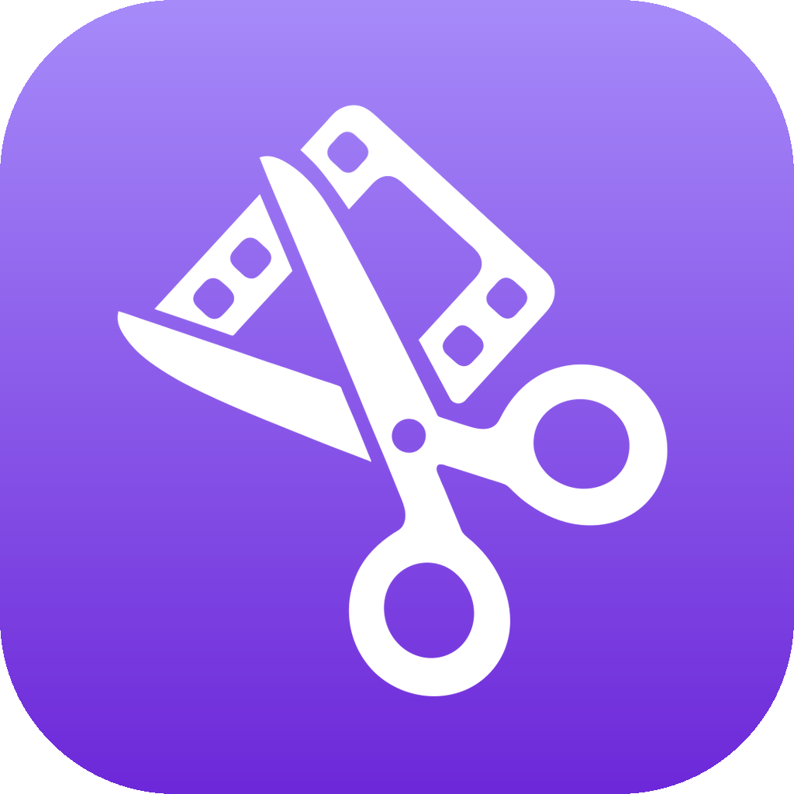
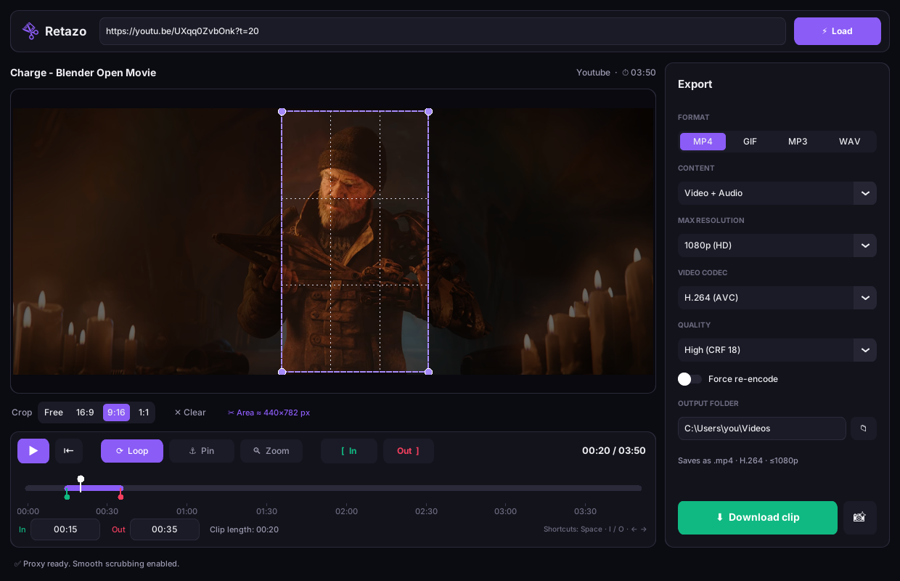

<div align="center">



# Retazo

**Clip and download just the part of a video you need.**

Paste a URL, set the in and out points, crop the frame if you want, and export to MP4, GIF, MP3 or WAV.


[](LICENSE)
[](https://github.com/sponsors/Gabo-Salcedo)



<sub>Screenshot shown with English labels; the app's interface is currently in Spanish.<br>
Sample frame from <a href="https://studio.blender.org/films/charge/"><i>Charge</i></a> (2022), an open movie by Blender Studio. © Blender Foundation | studio.blender.org</sub>

</div>

---

## What it does

*Retazo* is Spanish for "scrap" or "remnant", a piece cut from something larger. It's a desktop app for grabbing **clips** from online videos without downloading the whole video or opening an editor:

- **Time trimming** with a timeline, in/out markers, zoom and a preview with audio.
- **Spatial crop** by dragging over the video, free-form or locked to 16:9, 9:16 or 1:1.
- **Multiple formats**: MP4 (H.264, H.265/HEVC or VP9), optimized GIF, MP3, WAV, or audio-only M4A.
- **Exact YouTube downloads**: fetches only the requested section (`--download-sections`), not the full video.
- **Other sites** (TikTok, Instagram, Pinterest, X…): anything [yt-dlp](https://github.com/yt-dlp/yt-dlp) supports. Trimming happens locally with frame accuracy.
- **Frame capture** to PNG at the highest available resolution, with the crop applied.
- **Safe with your files**: never overwrites (`Title [00.32-01.11] (2).mp4`), and a cancelled or failed export leaves no half-written files behind.

## Requirements

| | |
|---|---|
| OS | Windows 10 or 11 |
| Python | 3.12 recommended ([python.org](https://www.python.org/downloads/); tick *Add python.exe to PATH*) |
| FFmpeg | On PATH, or install with `winget install Gyan.FFmpeg` |
| JS runtime | For YouTube, yt-dlp needs [Deno](https://deno.com) or [Node.js](https://nodejs.org) (`winget install DenoLand.Deno`) |

## Installation

```bat
git clone https://github.com/Gabo-Salcedo/Retazo.git
cd Retazo
setup.bat
```

`setup.bat` installs the Python dependencies (`requirements.txt`), checks yt-dlp, and offers to install FFmpeg with winget if it can't find it.

<details>
<summary>Manual install</summary>

```bat
python -m pip install -r requirements.txt
python main.py
```
</details>

## Usage

1. Run **`run.bat`**.
2. Paste the URL at the top and click **Cargar** (Load), or press Enter.
3. Set the range: drag the green/red markers, use **[ Inicio / Fin ]** (In / Out) at the playhead, or type the times (`MM:SS` or `HH:MM:SS`).
4. *(Optional)* Drag over the video to crop the frame.
5. Pick format and quality in the **Exportar** (Export) panel and click **Descargar fragmento** (Download clip).

### Keyboard shortcuts

| Key | Action |
|---|---|
| `Space` | Play / pause |
| `I` / `O` | Set in / out point at the playhead |
| `←` / `→` | Jump back / forward 5 s |
| `Shift` + `←` / `→` | Step back / forward one frame |
| `Home` | Play from the in point |
| `L` | Toggle loop |
| `Z` | Zoom the timeline to the selected range |
| `Ctrl` + `S` | Download |

Shortcuts are ignored while you're typing in a text field.

### Output formats

| Format | Result |
|---|---|
| MP4 · Video + Audio | H.264 / H.265 / VP9. On YouTube, with no crop, High quality and H.264, streams are copied without re-encoding (fast, lossless). |
| MP4 · Video only | Same, without an audio track. |
| MP4 · Audio only | `.m4a`, AAC 192 kbps. |
| GIF | 15 fps, max 720 px wide, optimized palette. Adjustable via `gif_fps` and `gif_width` in `config.json`. |
| MP3 | High-quality VBR (`-q:a 2`). |
| WAV | Uncompressed 16-bit PCM. |

## How it works

```
URL ──► yt-dlp ──► temp folder ──► FFmpeg ──► atomic rename ──► final file
         │  YouTube: only the section     │ spatial crop, codec,
         │  others:  full video           │ quality, local trimming
```

- The preview uses **ffpyplayer** with a low-resolution local proxy for lag-free scrubbing.
- Everything is written to `.retazo_tmp_*` and only moved to its final name at the end (an idea borrowed from [Cap](https://github.com/CapSoftware/Cap)'s exporter).
- Heavy work runs on background threads; the UI is only ever updated from the main thread.

## Project structure

```
├── main.py                  Entry point
├── run.bat / setup.bat      Windows launcher and installer
├── core/
│   ├── downloader.py        Download (yt-dlp) + processing (FFmpeg)
│   ├── config.py            Persistent settings (config.json)
│   ├── utils.py             Paths, time parsing, file names
│   └── ytdlp_runner.py      Runs yt-dlp with Windows certificates
├── ui/
│   ├── main_window.py       Main window
│   └── theme.py             Palette, components and tooltips
├── assets/                  App icon (SVG source, PNG, ICO)
├── preview/player_window.py Timeline and player
└── download/download_window.py  Progress window
```

## Troubleshooting

| Problem | Fix |
|---|---|
| *Falta 'ffpyplayer' para la vista previa* (ffpyplayer missing) | Run `setup.bat` or `python -m pip install ffpyplayer`. |
| *ffmpeg* not found | `winget install Gyan.FFmpeg`, then restart the app. |
| YouTube fails to load | Update yt-dlp (`python -m pip install -U yt-dlp`) and install Deno or Node.js. |
| Error says *Video unavailable* / *Sign in* | The video is private, age-restricted or region-locked. |

## Responsible use

Retazo is meant for content you own, content in the public domain, or content you have permission to use (quotes, commentary, your own material…). Respect copyright and each platform's terms of service.

## Credits

- [yt-dlp](https://github.com/yt-dlp/yt-dlp): extraction and downloading.
- [FFmpeg](https://ffmpeg.org): video and audio processing.
- [CustomTkinter](https://github.com/TomSchimansky/CustomTkinter): UI toolkit.
- [ffpyplayer](https://github.com/matham/ffpyplayer): preview with synced audio.
- Design inspired by [Cap](https://github.com/CapSoftware/Cap).
- Screenshot frame: [*Charge*](https://studio.blender.org/films/charge/) by Blender Studio (Blender Foundation open movie).

## Support the project

Retazo is free and open source. If it saves you time, you can support its development through [GitHub Sponsors](https://github.com/sponsors/Gabo-Salcedo) ♥

## License

[MIT](LICENSE) © 2026 Gabo Salcedo.

Third-party components keep their own licenses (yt-dlp, FFmpeg, CustomTkinter, ffpyplayer…). The sample frame in `docs/screenshot.png` is from *Charge* © Blender Foundation and is not covered by this project's license.
